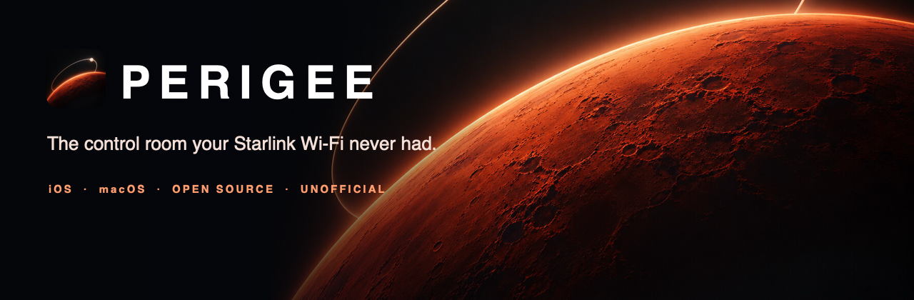
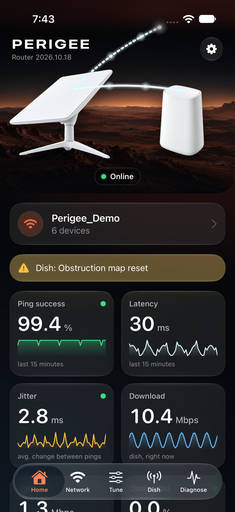
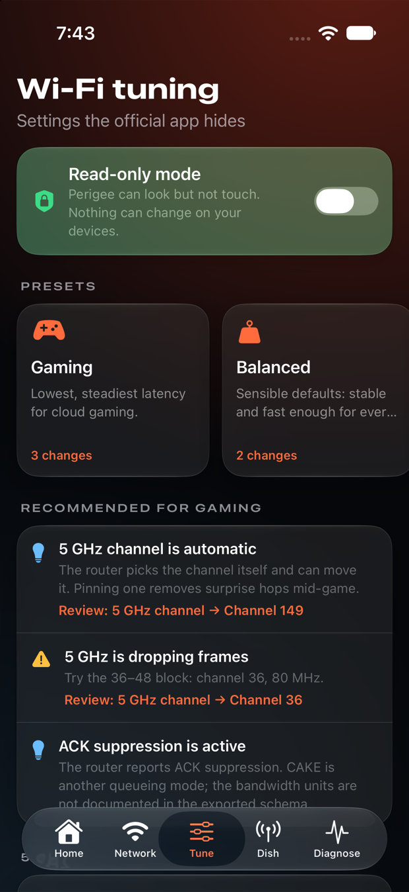
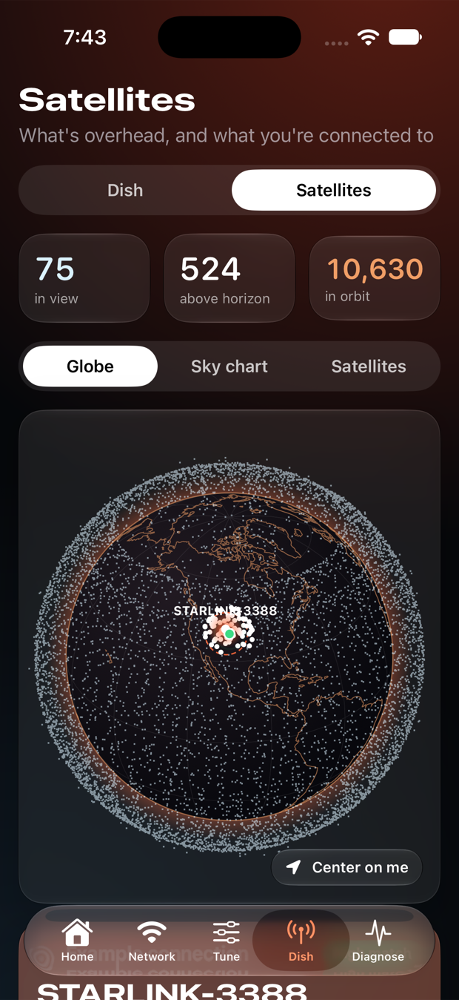
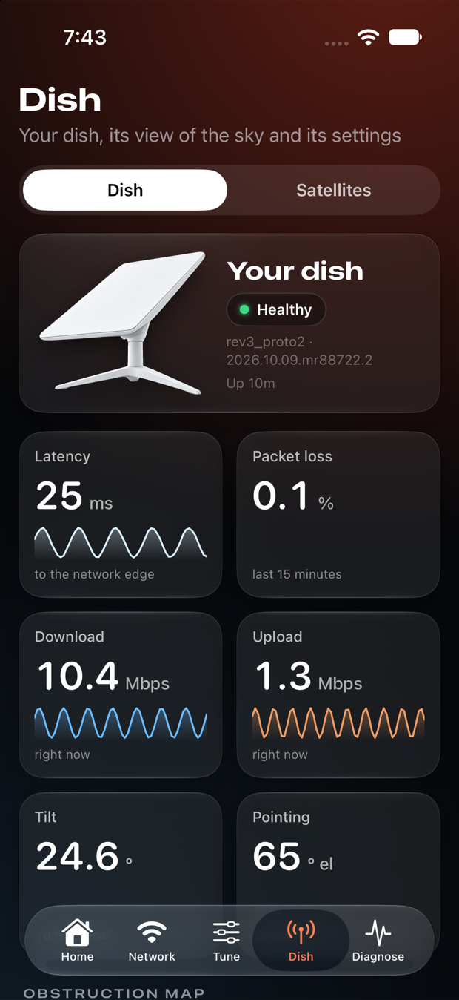
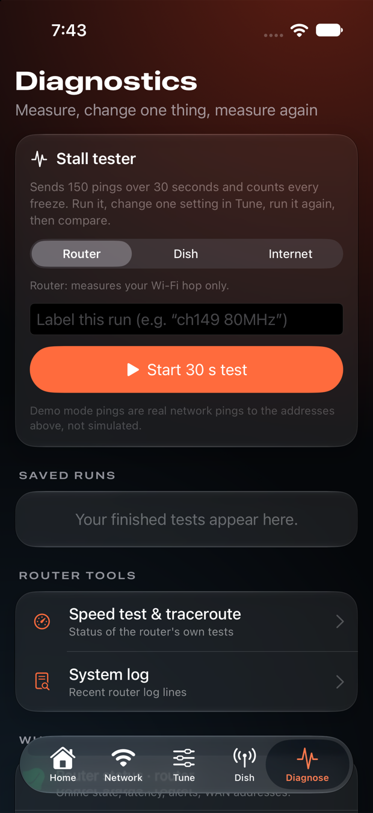
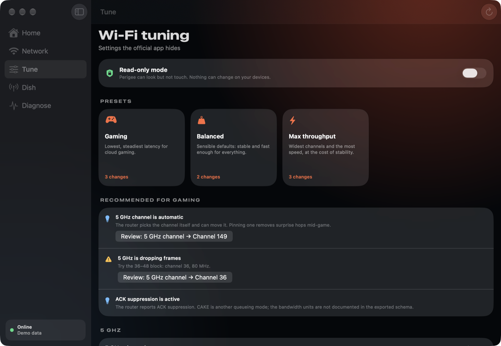
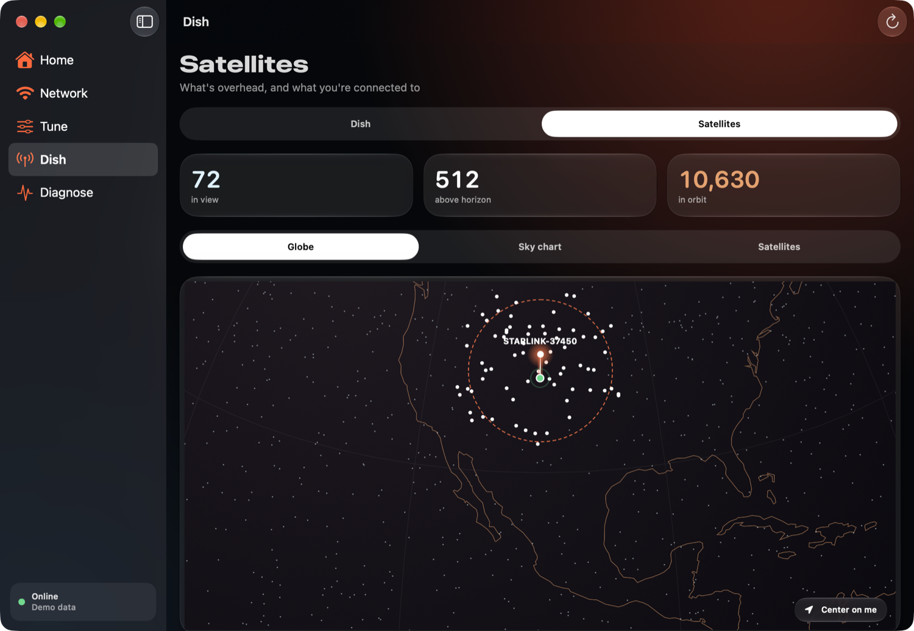

<p align="center"></p>

<p align="center">
  <a href="https://noktirnal42.github.io/perigee/"></a>
  
  
  
</p>

<p align="center"><b>A native SwiftUI companion for Starlink's local router &amp; dish API.</b><br>
Tune the Wi-Fi settings the official app hides, measure stalls and bufferbloat, and watch the satellites overhead — read-only by default, one verified change at a time.</p>

> [!IMPORTANT]
> **Perigee is unofficial.** It is not made, endorsed, sponsored or supported by SpaceX or Starlink. It speaks the gRPC API that your own router and dish expose on your own network. Use it only on equipment you own. See [Legal](#legal).

<p align="center">
  
  
  
  
  
</p>

## Contents
[Why](#why) · [Features](#features) · [Quick start](#quick-start) · [Using Perigee](#using-perigee) · [Safety model](#safety-model) · [Architecture](#architecture) · [Testing](#testing) · [Limitations](#known-limitations) · [Legal](#legal)

## Why

Cloud gaming exposes problems that speed tests hide. On a Starlink setup that looks healthy — dish ping success 99.9%, ~23 ms — you can still get a **~1 s freeze every few seconds** on the Wi-Fi hop, 1–4% loss, and a 5 GHz radio quietly dropping ~2% of received frames. The official app can't change the channel, width, DFS, or traffic queueing behind that. The router's local API can.

Perigee surfaces that API as a polished, safe, A/B-testable app.

## Features

| | |
|---|---|
| **Wi-Fi tuning** | Channel, width (HT/VHT), wireless mode, TX power, DFS, band steering, per-band on/off, hidden SSID, DNS + secure DNS, **CAKE** queue and ACK filter, DSCP — with presets (*Gaming · Balanced · Max throughput*), plain-language explanations and impact warnings. |
| **Verified writes** | Each change sets **exactly one field + its `apply_` flag**, re-reads the router to confirm, and offers a one-tap **revert**. |
| **Stall tester** | 150 ICMP probes over 30 s: loss, median, p95, stall episodes and cadence. Save runs and **A/B-compare** them with Swift Charts. |
| **Radio health** | Per-band frame-error rate, antenna RSSI, temperature, airtime → plain verdicts ("Dropping frames (1.8%)"). |
| **Satellites** | 3D globe of the whole constellation, a polar sky chart, what's above your horizon, and the satellite your dish is **probably** connected to. |
| **Dish** | Status, obstruction map, 15-minute history, snow melt, sleep schedule, update window, tilt, stow (slide-to-confirm). |
| **Network** | Devices with band/RSSI/link rate/history, rename, nodes, guest networks, Wi-Fi details (passwords masked behind Face ID / Touch ID). |
| **Honest capability map** | Perigee probes each call at connect time and shows what the router refuses on the LAN (e.g. `PermissionDenied`) instead of failing silently. |
| **Native everywhere** | iPhone, iPad and a real Mac app: sidebar, toolbar, keyboard shortcuts, menu-bar extra with live ping, Dynamic Type, VoiceOver, Reduce Motion, dark-first design. |

<p align="center">
  
  
</p>

## Quick start

**Requirements:** Xcode 16 or newer (built with Xcode 27), macOS 15+ to build, a Starlink router (Gen 2 tested) on the same network. No account, cloud service or telemetry.

```bash
git clone https://github.com/noktirnal42/perigee
cd perigee
open Perigee.xcodeproj
```

1. Pick the **Perigee_macOS** or **Perigee_iOS** scheme and press **⌘R**.
2. For a physical iPhone/iPad, select your device and set a signing team under *Signing & Capabilities*, or from the command line:
   ```bash
   xcodebuild -project Perigee.xcodeproj -scheme Perigee_iOS -destination 'id=<DEVICE_UDID>' \
     -allowProvisioningUpdates DEVELOPMENT_TEAM=<YOUR_TEAM_ID> build
   ```
3. On iOS, allow **Local Network** access when prompted — without it the OS blocks connections to `192.168.1.1`.
4. Join your Starlink Wi-Fi (or plug into the router). Perigee finds the router at `192.168.1.1:9000` and the dish at `192.168.100.1:9200` (editable in Settings).

**No hardware handy?** Settings → *Data source* → **Demo data**, or launch with the `-demo` argument. Everything works against a built-in sample network.

The Xcode project is generated from [`project.yml`](project.yml) with [XcodeGen](https://github.com/yonaskolb/XcodeGen) (`brew install xcodegen && xcodegen generate`).

## Using Perigee

The recommended loop for fixing stalls (full walk-through in the [tuning guide](https://noktirnal42.github.io/perigee/guide.html)):

1. **Diagnose → Stall tester** against the *Router* target. Label it "baseline".
2. **Tune** → pin a non-DFS 5 GHz channel (36–48 or 149–161), turn DFS off, use 80 MHz, and consider CAKE at ~90% of your line speed.
3. Run the stall tester again, then **Compare** the runs.
4. Not better? **Revert** from the change log.

Writes are **off at every launch**. Flip *Enable writes* at the top of the Tune tab when you're ready; a banner shows while it's on.

## Safety model

* **Read-only by default**, with a visible switch and banner.
* **A policy in code, not just UI:** every request is classified by name in `GuardedTransport`. Authentication, signing, `sensitive_request`, remote SSH, debug, `*test_mode`, factory/reset and firmware methods can **never** be sent — and **unknown methods are blocked**.
* **Destructive actions** (reboot, stow) require writes enabled *and* a completed slide-to-confirm.
* **Single-field writes**, verified by re-reading, with stale-value detection and one-tap revert.
* **Secrets:** Wi-Fi passwords are masked until you authenticate, never kept in view state, never logged, and omitted from exported reports. Your location stays on-device.
* **Development hygiene:** no test or build step calls a write against real hardware; write paths are developed against an in-memory mock router.

Details: [API & safety model](https://noktirnal42.github.io/perigee/api.html).

## Architecture

```
App/Shared      SwiftUI: design system, procedural Mars + hero art, Home / Network / Tune / Dish / Satellites / Diagnose
App/iOS, macOS  Asset catalogs (generated icon), entitlements
Packages/StarlinkKit
  RouterAPI / DishAPI   protobuf + grpc-swift stubs generated from reference/*.protoset
  StarlinkKit           transports · safety policy · services · domain models · tuning · advisor · SGP4 · mocks
  perigee-probe         read-only live CLI
reference/      exported device schemas (.protoset) and the original ab.sh stall script
Scripts/        proto generation, app-icon renderer
docs/           GitHub Pages site
```

* **Protocol-based clients** (`RouterTransport`, `DishTransport`) so a mock backs previews, demo mode and tests.
* **Swift 6 concurrency**, actors for device services, `@Observable` session for UI, no force unwraps in networking.
* **Procedural art:** the Mars terrain, dish and router renders, beams and the app icon are all drawn in code — no bitmap assets, nothing copied from Starlink.

Regenerate the protocol stubs with `Scripts/generate-protos.sh` (see the script header for the plugin build).

## Testing

```bash
cd Packages/StarlinkKit && swift test     # 40+ tests, no hardware touched
swift run perigee-probe                   # read-only decode check against your live router & dish
swift run perigee-probe ping              # 30 s ICMP stall test
```

Tests cover single-field/`apply_` construction for every setting, revert and stale-value logic, the safety gate (including every forbidden method), fixture decoding, stall analysis, and the SGP4 propagator against the standard reference vectors.

## Known limitations

* Over the LAN the router refuses `wifi_get_channels`, `wifi_get_ping_metrics` and `wifi_get_traceroute_status`, and the dish refuses `get_location`. Perigee shows this in the app. It does not know what credentials would unlock them.
* The **CAKE bandwidth unit** isn't stated in the exported schema; Perigee assumes Mbit/s and tells you to verify.
* The **connected satellite is an inference** (closest to the dish's reported boresight), not something Starlink publishes.
* Satellite positions come from CelesTrak element sets (bundled snapshot + refresh); accuracy degrades if they're days old.
* Tested on a Gen 2 router and the dish firmware current at the time of writing; other firmware may differ.

## Legal

Perigee is released under the [MIT License](LICENSE). It is an independent project and is **not affiliated with, endorsed by, or sponsored by SpaceX or Starlink**. "Starlink" is a trademark of its owner and is used only to describe compatibility. Perigee contains no Starlink logos, wordmarks or artwork, and was built from the schema the devices themselves publish via gRPC reflection — no app was decompiled. Orbital data courtesy of [CelesTrak](https://celestrak.org); coastlines from [Natural Earth](https://www.naturalearthdata.com) (public domain). You are responsible for how you use it; changing router settings can interrupt your network.
